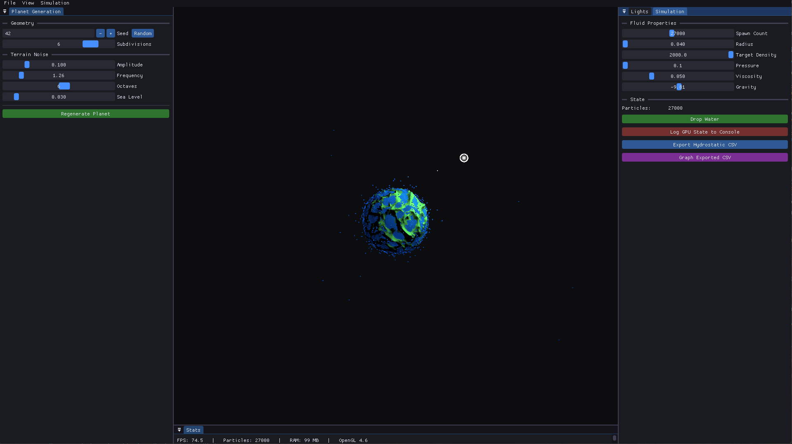
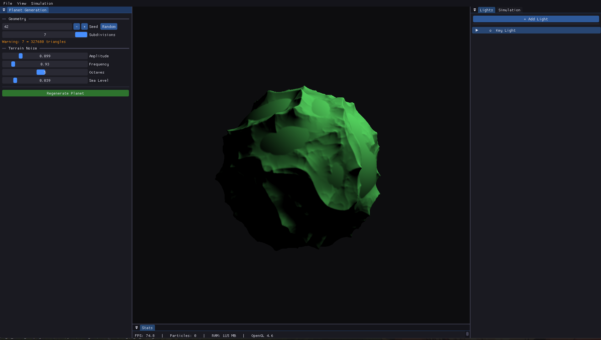
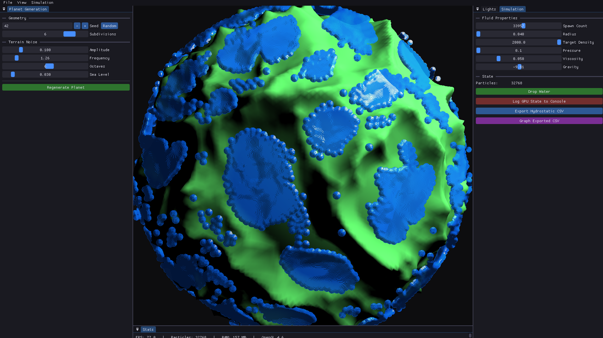
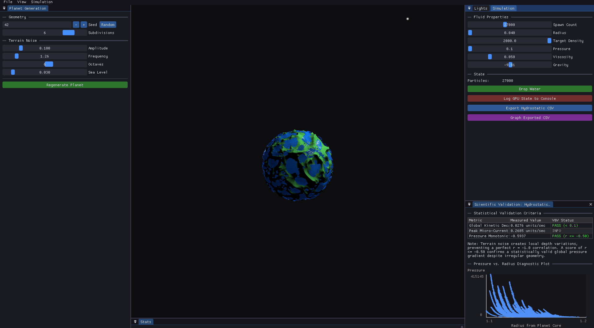

# Scientific Engine (C++ / OpenGL 4.6)

> A real-time procedural planet generator and GPU-accelerated fluid simulator, built from scratch.

I'm Ayodeji. I built this engine because I'm fascinated by the intersection of mathematics, graphics programming, and low-level systems work. Rather than using Unity or Unreal, I wanted to build the rendering pipeline from the ground up — from GLSL shaders and GPU buffer management to procedural geometry, compute-based physics, screen-space fluid rendering, and a custom editor.

<!-- SCREENSHOT: hero shot — planet + lit fluid surface + editor docked. See docs/images/hero.png -->


---

## What It Does

The engine generates procedural planets and runs a Smoothed Particle Hydrodynamics (SPH) fluid simulation on the GPU, with the fluid colliding against the planet's terrain — all in real-time inside an interactive editor.

### Procedural Planet Generation

Planets start as an icosahedron defined by the golden ratio φ = (1+√5)/2. The 12 base vertices are subdivided using edge-midpoint caching — each pass splits every triangle into four by inserting normalized midpoints on each edge, projecting them onto the unit sphere. At subdivision level 6, this produces 81,920 triangles and 40,962 vertices.

Terrain is sculpted using **Ridged Multifractal Noise**: 3D Simplex noise is passed through a ridge transform `(1 - |noise|)²` and layered across multiple octaves with frequency doubling and amplitude halving. A weight-feedback loop makes higher elevations accumulate more detail, producing realistic mountain-on-mountain terrain. All generation is seeded for deterministic reproduction. A sea-level floor flattens low elevations into oceans.

<!-- SCREENSHOT: planet close-up showing ridged terrain + Planet Generation panel. See docs/images/planet_terrain.png -->


### GPU Fluid Simulation (SPH)

A Smoothed Particle Hydrodynamics solver runs entirely on the GPU via OpenGL 4.6 compute shaders. Tens of thousands of particles (spawnable up to 60,000) simulate incompressible fluid dynamics through a multi-pass pipeline executed every frame:

1. **Spatial Hash Pass** (`sph_hash.comp`) — assigns each particle to a grid cell and writes a `[cellHash, particleIndex]` pair into the indices buffer.
2. **Bitonic Sort Pass** (`sph_sort.comp`) — sorts those pairs by cell hash on the GPU, driven by the classic `O(n log²n)` bitonic dispatch loop, so particles in the same cell become contiguous in memory.
3. **Offset Pass** (`sph_offsets.comp`) — builds a per-cell start-offset table so each particle can find its cell's neighbors in `O(1)`.
4. **Density & Pressure Pass** (`sph_density.comp`) — computes per-particle density using the Poly6 smoothing kernel over the 27 neighboring cells, then derives pressure from the Tait equation of state.
5. **Forces & Integration Pass** (`sph_forces.comp`) — computes pressure-gradient forces (Spiky kernel), viscosity forces (viscosity-kernel Laplacian), and gravity; integrates with semi-implicit Euler. The same ridged-noise function used to build the planet is evaluated here so the fluid **collides against the actual terrain surface**, not just a flat box.

The spatial-hash neighbor search replaces the old `O(N²)` brute-force scan with a grid-based `O(N)` search. Physics is also **sub-stepped** (two micro-steps per frame) for numerical stability under large pressure multipliers.

The particle buffer lives in a single SSBO that is dual-bound as both a compute storage buffer and a vertex attribute buffer — the renderer reads directly from the same VRAM the compute shaders write to, with zero CPU readback.

### Screen-Space Fluid Rendering (SSFR)

Rather than drawing particles as flat dots, the fluid is rendered as a continuous liquid surface using a screen-space, multi-pass technique:

1. **Depth Pass** (`ssfr_depth.*`) — particles are splatted as spheres into an off-screen framebuffer, writing eye-space depth.
2. **Bilateral Blur Pass** (`ssfr_blur.frag`) — an edge-preserving blur smooths the depth field into a coherent surface while keeping silhouette edges crisp.
3. **Composite Pass** (`ssfr_debug.frag`) — surface normals are reconstructed from the smoothed depth using **adaptive central differences** (which fall back near silhouettes to avoid haloing), then shaded with the scene's dynamic point lights and composited over the planet.

<!-- SCREENSHOT: SSFR liquid surface — show the smooth shaded fluid blob, ideally mid-collision with terrain. See docs/images/ssfr_fluid.png -->


### Lighting & Shading

Lambertian diffuse shading with inverse-square attenuation supports up to 8 dynamic point lights, applied to both the planet and the fluid surface. Lights are rendered as GPU point sprites with circular billboard fragment shading and selection-ring overlays. They are pickable via mouse ray-casting (ray-sphere intersection in NDC → world space) and draggable along the camera's view-plane axes.

### Editor

An integrated Dear ImGui (docking branch) editor provides a dockable, persistent multi-panel workspace:

- **Planet Generation** — seed (with randomizer), subdivision level, noise amplitude/frequency/octaves, sea level
- **Simulation** — particle spawn count, smoothing radius, target density, pressure, viscosity, gravity; drop-water trigger; GPU state console dump; CSV export
- **Lights** — add/remove/select lights, drag position, color picker, intensity
- **Scientific Validation: Hydrostatic Equilibrium** — verifies the settled fluid against physics: global kinetic decay, peak velocity, and a Pearson-correlation monotonicity check on the pressure-vs-radius profile, with a live scatter plot
- **Architecture & Memory Profiler** — live process RAM (working set / peak / committed), `std430` struct-alignment checks, per-SSBO VRAM footprint, and CPU staging-heap addresses
- **Stats bar** — FPS, particle count, RAM, OpenGL version


<!-- SCREENSHOT: Scientific Validation panel showing PASS rows + the pressure/radius scatter plot. See docs/images/validation_panel.png -->


<!-- SCREENSHOT: Architecture & Memory Profiler panel (RAM + VRAM + alignment tables). See docs/images/memory_profiler.png -->


---

## Controls

| Input             | Action                                            |
|-------------------|---------------------------------------------------|
| Left-drag         | Orbit camera                                      |
| Scroll wheel      | Zoom in / out                                     |
| Left-click        | Pick a light (ray-cast)                           |
| `G` + drag        | Move the selected light along the view plane      |
| `F11`             | Toggle borderless fullscreen                      |
| `Esc`             | Quit                                              |
| Drop Water button | Spawn / reset the fluid block                     |

The window is freely resizable; the camera aspect ratio and the SSFR framebuffers are reallocated dynamically on resize.

---

## Architecture

```
Application (main loop owner)
├── GraphicsContext     — SDL2 window + OpenGL 4.6 core context
├── Input               — SDL keyboard/mouse polling
├── Renderer            — stateless draw calls (planet, lights, SSFR fluid)
│   └── Framebuffer[]   — off-screen targets for the SSFR passes
├── Editor              — ImGui lifecycle + all UI panels
└── Scene               — owns all world state
    ├── Camera          — orbital (spherical coordinates)
    ├── Icosahedron     — procedural planet mesh
    ├── PointLight[]    — dynamic lights with ray-pick selection
    └── SphSolver       — GPU fluid simulation
        ├── sph_hash.comp     — spatial cell hashing
        ├── sph_sort.comp     — GPU bitonic sort
        ├── sph_offsets.comp  — per-cell offset table
        ├── sph_density.comp  — Poly6 density + equation of state
        └── sph_forces.comp   — Spiky pressure + viscosity + terrain collision + Euler integration
```

The frame loop executes four phases: **Input → Physics → Render → UI**. The `Scene` owns all simulation state; the `Renderer` is stateless and receives everything it needs per call. GPU resources (VAOs, SSBOs, FBOs, shader programs) are protected by deleted copy constructors — only move semantics are permitted.

---

## Tech Stack

| Component     | Choice                                |
|---------------|---------------------------------------|
| Language      | C++20                                 |
| Graphics API  | OpenGL 4.6 (Core Profile)             |
| GPU Compute   | OpenGL Compute Shaders (GLSL 460)     |
| GL Loader     | GLAD                                  |
| Windowing     | SDL2                                  |
| Math          | GLM                                   |
| UI            | Dear ImGui (Docking Branch)           |
| Build         | CMake + vcpkg                         |
| Testing       | Google Test                           |
| Logging       | spdlog                                |

---

## Directory Structure

```
├── assets/shaders/         # GLSL shaders (vertex, fragment, compute)
│   ├── planet.vert/frag    # Planet mesh rendering + Lambertian lighting
│   ├── light.vert/frag     # Point sprite light billboards
│   ├── particle.vert/frag  # Raw point-sprite particle rendering
│   ├── fullscreen.vert     # Fullscreen-triangle vertex stage (SSFR passes)
│   ├── ssfr_depth.vert/frag# SSFR pass 1: sphere depth splatting
│   ├── ssfr_blur.frag      # SSFR pass 2: bilateral depth blur
│   ├── ssfr_debug.frag     # SSFR pass 3: normal reconstruction + lit composite
│   ├── sph_hash.comp       # Compute: spatial cell hashing
│   ├── sph_sort.comp       # Compute: GPU bitonic sort
│   ├── sph_offsets.comp    # Compute: per-cell offset table
│   ├── sph_density.comp    # Compute: Poly6 density + pressure EOS
│   └── sph_forces.comp     # Compute: Spiky/viscosity forces + terrain collision + integration
├── include/
│   ├── core/               # Application, Camera, Shader, ComputeShader, Renderer, Framebuffer, etc.
│   ├── geometry/           # Icosahedron (procedural mesh)
│   ├── physics/            # Particle, SphParams, SphSolver
│   └── ui/                 # Editor (ImGui panels)
├── src/                    # Implementation files (mirrors include/ layout)
├── docs/images/            # README screenshots & media
└── tests/                  # Google Test suite
```

---

## Building

**Prerequisites:** Visual Studio 2026 (MSVC), CMake ≥ 3.20, Git, and vcpkg (with `VCPKG_ROOT` set in your environment)

```bash
git clone https://github.com/Ayonator77/Scientific-Engine.git
cd Scientific-Engine
.\run.bat
```

`run.bat` configures the project on first run (`cmake --preset msvc`) and then builds and launches it. The build uses vcpkg for dependency management (SDL2, GLAD, GLM, spdlog, Google Test) and fetches ImGui's docking branch via CMake's FetchContent. No prebuilt binaries are stored in the repo.

**Manual build:**
```bash
cmake --preset msvc
cmake --build build/msvc --config Debug --target run
```

---

## SPH Math Reference

The fluid simulation implements the Navier-Stokes equations discretized over particles:

**Density estimation** (Poly6 kernel):
```
ρᵢ = Σⱼ mⱼ · W_poly6(‖rᵢ - rⱼ‖, h)
W_poly6(r, h) = (315 / 64πh⁹) · (h² - r²)³    for r < h
```

**Pressure** (Tait equation of state):
```
pᵢ = k · (ρᵢ - ρ₀)
```

**Pressure force** (Spiky kernel gradient):
```
Fᵢ_pressure = -Σⱼ mⱼ · (pᵢ + pⱼ)/(2ρⱼ) · ∇W_spiky
∇W_spiky(r, h) = -(45/πh⁶) · (h - r)² · (r̂/r)
```

**Viscosity force** (Laplacian kernel):
```
Fᵢ_visc = μ · Σⱼ mⱼ · (vⱼ - vᵢ)/ρⱼ · ∇²W_visc
∇²W_visc(r, h) = (45/πh⁶) · (h - r)
```

**Integration** (semi-implicit Euler with damping, sub-stepped):
```
v += a · dt
v *= 0.995          (energy bleed for stability)
x += v · dt
```

---

## Project Status

This is an active prototype. The planetary generation pipeline, GPU SPH fluid simulation, screen-space fluid rendering, and editor are all functional.

**What's working:**
- Procedural planet generation with seeded, deterministic output
- Icosahedral subdivision with edge caching (up to 327k triangles)
- Ridged multifractal noise terrain with weight-feedback octaves
- GPU-accelerated SPH fluid simulation (multi-pass compute pipeline)
- Spatial-hash + GPU bitonic-sort neighbor search (O(N))
- Fluid-vs-terrain collision against the procedural planet surface
- Sub-stepped semi-implicit Euler integration for stability
- Screen-space fluid rendering (depth → bilateral blur → normal reconstruction → lit composite)
- Adaptive central-difference normal reconstruction with silhouette handling
- Dual SSBO/VBO binding for zero-copy particle rendering
- Lambertian diffuse shading with up to 8 dynamic point lights
- Interactive point lights with ray-cast picking and drag movement
- ImGui docking editor with planet, fluid, and light controls
- Scientific validation panel (hydrostatic equilibrium, Pearson correlation, scatter plot)
- Architecture & memory profiler (RAM, VRAM/SSBO footprint, struct alignment)
- Dynamic resolution scaling and F11 borderless fullscreen
- GPU VRAM multi-frame diagnostic dump and hydrostatic CSV export

**What's planned:**
- Elevation-based biome fragment shading
- N-Body orbital mechanics (Verlet/RK4 integration)
- General relativity visualization experiments
- Particle LOD and adaptive timestep

---

## Screenshots

Drop the following images into [`docs/images/`](docs/images/) (PNG, ideally 1600px+ wide) to populate this README:

| File                              | What to capture |
|-----------------------------------|-----------------|
| `docs/images/hero.png`            | The money shot — a planet with the lit fluid surface and the docked editor visible. Use this at the top of the README. |
| `docs/images/planet_terrain.png`  | A close-up of the planet showing the ridged-mountain terrain, with the **Planet Generation** panel open (so the noise sliders are visible). |
| `docs/images/ssfr_fluid.png`      | The screen-space fluid surface — capture the smooth, shaded liquid blob mid-fall or mid-collision with the terrain, to show it's a surface and not dots. |
| `docs/images/editor_overview.png` | The full editor: all panels docked (Planet, Simulation, Lights, Validation, Profiler, Stats bar) around the 3D viewport. |
| `docs/images/validation_panel.png`| The **Scientific Validation** panel with PASS rows showing and the pressure-vs-radius scatter plot rendered (export + graph a settled sim first). |
| `docs/images/memory_profiler.png` | The **Architecture & Memory Profiler** panel showing the RAM, VRAM/SSBO footprint, and struct-alignment tables. |

Optional extras worth adding: a short GIF/MP4 of fluid pouring over the terrain (`docs/images/fluid_pour.gif`), and a wireframe vs. shaded comparison of the icosahedron at different subdivision levels.

---

## License
</content>
</invoke>
